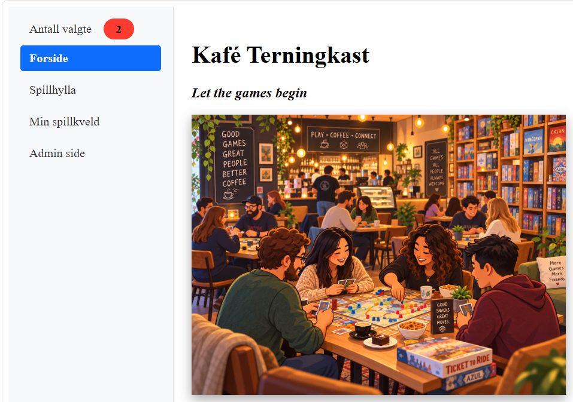
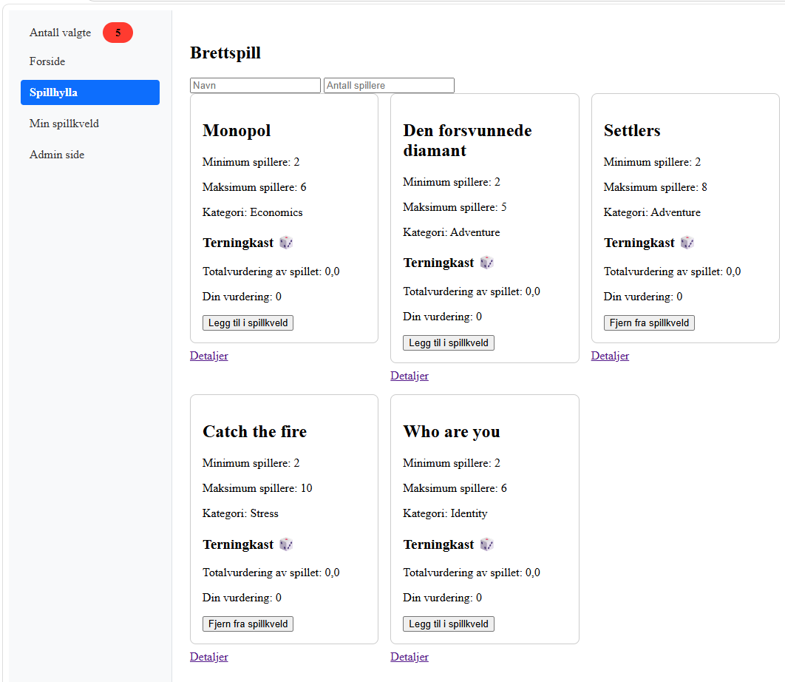
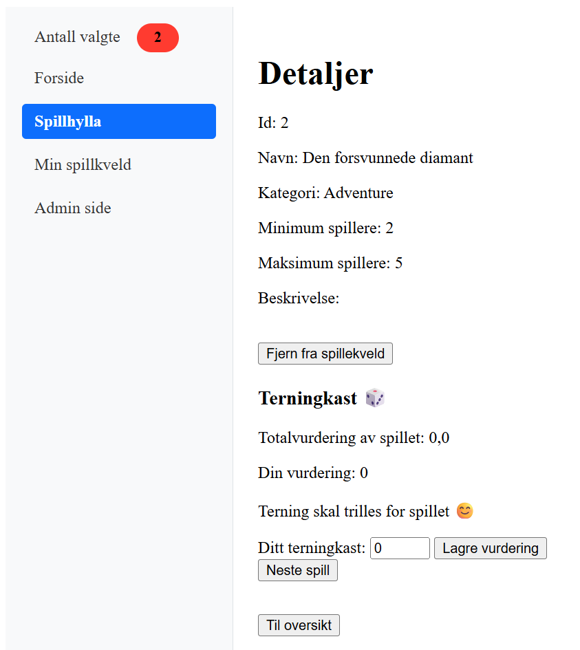
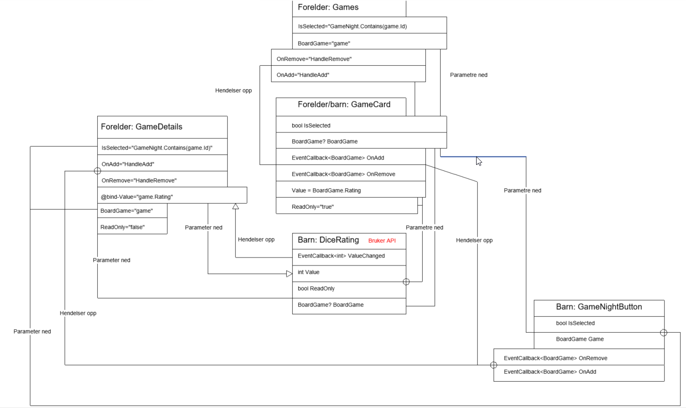
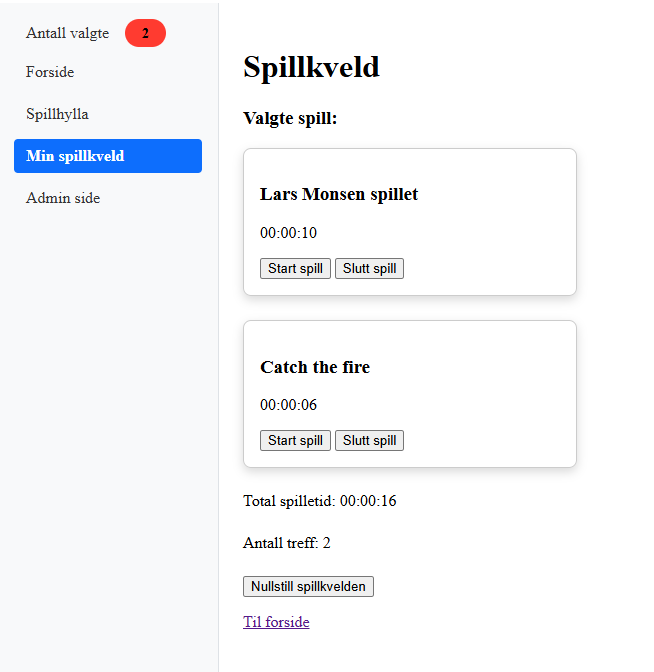
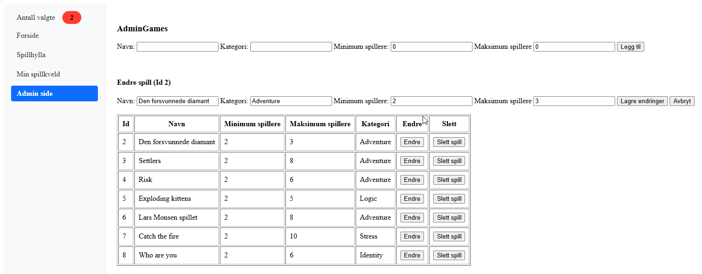
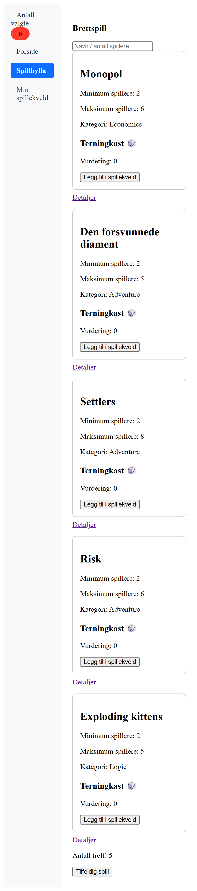
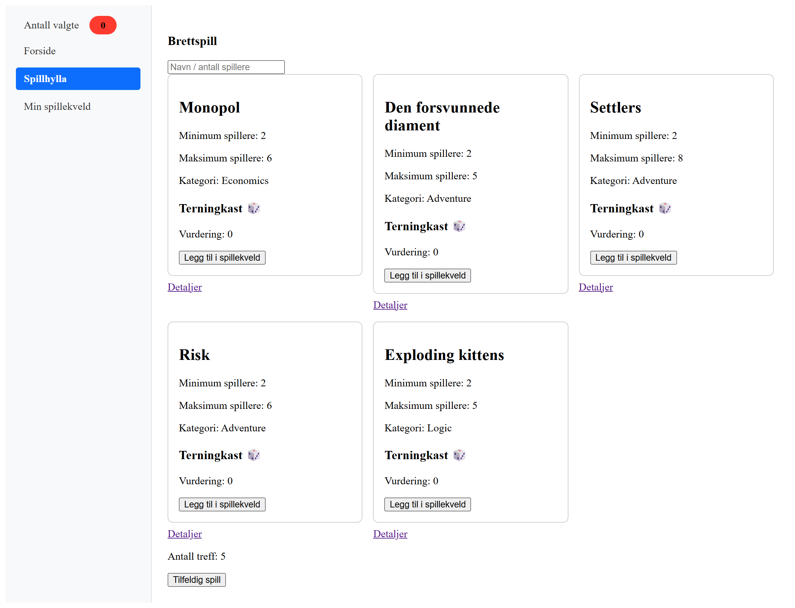

# Arbeidskrav Software Design
* Utvikler: Kristian Spikkeland
* Lenke til Github: https://github.com/kristianSpikkeland/AK-Software-Design.git

## Velkomstside


## Kjøring
Programmet kjøres med play knappen. Utforming på denne avhengiger av kodeeditor. Alternativt kan man bruke terminalen:
```txt
dotnet run --project AK2 --launch-profile https
```
For deretter å åpne nettleser med adressen: https://localhost:7259

Det er satt opp et eget testprosjekt. Xunit og bUnit er brukt som et ekstra rammeverk for tester. Høyreklikk på testprosjekt med navn AK2Test og velg Run Tests. Alternativt i terminal:
```
dotnet test 
```

## Struktur
For mer detajert KI bruk med blant annet spørsmål og svar. Se fil med navn: AI_Q&A.md <br>
For PDFer som KI har produsert til meg se vedleggsmappen. <br>
I vedleggsmappen ligger også tegninger relatert til oppgave 5. <br>
Generell KI bruk og refleksjoner er gjort rede for mot slutten av dette dokumentet. <br>

## Oppgave 1
### Siden


### Info 
Siden Games har ansvar for å vise alle spill og bruker GameCard som er en gjenbrukbar komponent.
GamesDetail viser detaljene for et spill. På Games siden er det lagt til lenker som man kan klikke på for å komme til detaljene for et spill.
Grunnen til at jeg valgte å gjøre det slik var siden jeg har forsøkt å tenke på brukeren og at brukergrensesnittet skal være minimalistisk og ryddig. 
På samme grunnlag er derfor filteret for antall spillere bakt inn sammen med navn filteret. Dette ble senere endret til to filtere for å oppfylle krav i oppgaveteksten. 
Videre har man tenkt en del rundt hvordan man kan lage en løsning som skalerer. Det å ha en GamesDetails side istedenfor en side per spill
har jeg ansett som gunstig.

### Kode av siden Games

<details>
<summary>Klikk for å vise mer</summary>

```
@page "/games";
@inject GameApiClient ApiClient
@inject GameNightState GameNight
@rendermode InteractiveServer
@implements IDisposable


<h2>Brettspill</h2>

<div class="search-box">
	<input type="search" autofocus @bind="nameFilter" @bind:event="oninput" @bind:after="ApplyFilter" 
		placeholder="Navn" />

	<input type="number" min="1" @bind="playerFilter" @bind:event="oninput" @bind:after="ApplyFilter"
		   placeholder="Antall spillere" />
</div>


@if (isLoading)
{
    <p>Laster spill...</p>
}
else if (error is not null)
{
    <p style="color:red">@error</p>
}
else if (!games.Any())
{
    <p>Det finnes ingen spill i samlingen.</p>
}
else if (!filteredGames.Any())
{
    <p style="color:red">Ingen treff</p>
}

<div class="game-grid">
	@foreach (var game in filteredGames)
	{
		<div class="game-cell" @key="game.Id">
			<GameCard BoardGame="game"
					  IsSelected="GameNight.Contains(game.Id)"
					  OnAdd="HandleAdd"
					  OnRemove="HandleRemove" />

			@if (messages.TryGetValue(game.Id, out var msg))
			{
				<p>@msg</p>
			}

			<a href="/games/@game.Id">Detaljer</a>
		</div>
	}
</div>

<br />
<br />

<p>Antall treff: @filteredGames.Count()</p>


<button @onclick="ShowRandomGame">Tilfeldig spill</button>

@if (randomGame != null)
{
	<p>@randomGame.Name</p>
}


@code {
	private IReadOnlyList<BoardGame> games = [];
	private bool isLoading = true;
	private string? error;

	string nameFilter = string.Empty;
	int? playerFilter;

	public BoardGame? randomGame;


	// Using StringComparison.CurrentCultureIgnoreCase to allow both uppercase and lowercase letters
	IEnumerable<BoardGame> filteredGames = [];

	protected override async Task OnInitializedAsync()
	{
		Console.WriteLine($"Games.OnInitializedAsync kjører. Renderer: {RendererInfo.Name}, interaktiv: {RendererInfo.IsInteractive}");
		GameNight.OnChange += OnGameNightChanged;
		try
		{
			games = await ApiClient.GetGamesAsync();
			ApplyFilter();
		}

		catch (HttpRequestException)
		{
        error = "Kunne ikke hente spillene. Prøv igjen senere.";
		}

		finally
		{
        isLoading = false;
		}			
	}

	private void OnGameNightChanged() => InvokeAsync(StateHasChanged);

	private void ApplyFilter()
	{
		var byName = GameFilter.FilterGames(nameFilter, games);
		filteredGames = GameFilter.FilterByPlayers(playerFilter, byName).ToList();
	}


	private async Task ShowRandomGame()
	{
		randomGame = GameFilter.GetRandomGame(games);
	}


	private readonly Dictionary<int, string> messages = new();

	private async Task HandleAdd(BoardGame game)
	{
		var text = await GameNight.AddAsync(game)
		? "Spillet ble lagt til"
		: "Spillet er allerede lagt til";

		messages[game.Id] = text;
		StateHasChanged();               // ← vis meldingen nå

		await Task.Delay(3000);

		// Fjern bare hvis det fortsatt er denne meldingen
		if (messages.TryGetValue(game.Id, out var current) && current == text)
			messages.Remove(game.Id);
	
	}
	private async Task HandleRemove(BoardGame game) => await GameNight.RemoveAsync(game.Id);

	public void Dispose() => GameNight.OnChange -= OnGameNightChanged;
}

```

</details>

### Kode av komponenten GameCard
<details>
<summary>Klikk for å vise mer</summary>

```C#
@inject GameNightState GameNight

<div class= "gameCard">
	<h2>@BoardGame.Name</h2>
	<p>Minimum spillere: @BoardGame.MinPlayers</p>
	<p>Maksimum spillere: @BoardGame.MaxPlayers</p>
	<p>Kategori: @BoardGame.Category</p>
	<DiceRating BoardGame="BoardGame" @key="BoardGame.Id" Value="BoardGame.Rating" ReadOnly="true" />

	<GameNightButton Game="BoardGame" IsSelected="IsSelected" OnAdd="OnAdd" OnRemove="OnRemove" />
	
</div>

@code {
	[Parameter] public BoardGame? BoardGame { get; set; }

	[Parameter] public EventCallback<BoardGame> OnAdd { get; set; }

	[Parameter] public EventCallback<BoardGame> OnRemove { get; set; }

	[Parameter] public bool IsSelected { get; set; }
}
```

</details>

## Oppgave 2
### Siden


### Komponentdiagram


### Parmetere og hendelser DiceRating
Som komponenttreet over viser er DiceRating en sentral del av systemet.
DiceRating har parametre for:
* EventCallback<int> ValueChanged
* int Value
* bool ReadOnly
* BoardGame? BoardGame

Det er forelderen GamesDetails som sender verdi for terningkast ned til DiceRating. Så kalles ValueChanged og hendelsen om at noe har skjedd når forelderen GameDetails.
GameCard bruker en lettere versjon av DiceRating enn GameDetails. Grunnen til dette er siden at man på Games siden ikke skal ha tilgang til å sette terningkast/vurdering.
Dette styres av ReadOnly parameteret. 

Utdag fra DiceRating. Komponentens parameter ReadOnly styrer visningen:
```
@if (ReadOnly == false)
{
	<p>Terning skal trilles for spillet 😊</p>
}
```

Utdrag fra GameCard. Legg merke til at ReadOnly er true:
```
<DiceRating BoardGame="BoardGame" @key="BoardGame.Id" Value="BoardGame.Rating" ReadOnly="true" />
```

### Parmetere for GameCard
GameCard har parametre for:
* bool IsSelected
* BoardGame? BoardGame
* EventCallback<BoardGame> OnAdd
* EventCallback<BoardGame> OnRemove

### Parameter verdier ned for GameCard og DiceRating
I tillegg sender GameCard følgende verdier for parametre ned til DiceRating for:

* Value = BoardGame.Rating
* ReadOnly="true"
* BoardGame="BoardGame"

### Videresending GameCard
Legg merke til hvordan GameCard setter komponenten GameNightButton:
```
<GameNightButton Game="BoardGame" IsSelected="IsSelected" OnAdd="OnAdd" OnRemove="OnRemove" />
```

IsSelected og hendelsene OnAdd og OnRemove er parametre som GameCard aldri setter men bringer videre. GameCard funker som et mellomledd for disse parametrene mellom Games og GameNightButton.  

### Kode av siden GamesDetails
<details>
<summary>Klikk for å vise mer</summary>
```C#
@page "/games/{Id:int}"
@inject GameApiClient ApiClient
@inject GameNightState GameNight
@inject NavigationManager Nav
@rendermode InteractiveServer
@implements IDisposable

@if (isLoading)
{
    <p>Laster spill...</p>
}
else if (error is not null)
{
    <p style="color:red">@error</p>
}

else if (game is not null)
{
	<h1>Detaljer</h1>
	<p>Id: @game.Id</p>
	<p>Navn: @game.Name</p>
	<p>Kategori: @game.Category</p>
	<p>Minimum spillere: @game.MinPlayers</p>
	<p>Maksimum spillere: @game.MaxPlayers</p>
	<p>Beskrivelse: @game.Description</p>
	<br />

	<GameNightButton Game="game"
                     IsSelected="GameNight.Contains(game.Id)"
                     OnAdd="HandleAdd"
                     OnRemove="HandleRemove" />
	
	@* Adding message to user if game was added to game night*@
	@if (message is not null)
    {
        <p>@message</p>
    }

	<DiceRating @ref="diceRating" BoardGame="game" @key="game.Id" ReadOnly="false"
				@bind-Value="game.Rating" @bind-Value:after="UpdateRating" />
}

else
{
	<p>Spill ikke funnet</p>
}

<button class="next-game" @onclick="GoNext">Neste spill</button>
<br />
<button @onclick="GoBack">Til oversikt</button>

@code {
	[Parameter] public int Id { get; set; }

	private BoardGame? game;

	private bool isLoading = true;

	private string? error;

	// The DiceRating component rendered on this page
	private DiceRating? diceRating;


	private void OnGameNightChanged() => InvokeAsync(StateHasChanged);


	protected override void OnInitialized()
	{
		GameNight.OnChange += OnGameNightChanged;
	}


	protected override async Task OnParametersSetAsync()
	{
		isLoading = true;
		error = null;
		game = null;

		try
		{
			game = await ApiClient.GetGameByIdAsync(Id);

			if (game is null)
			{
				Nav.NotFound();
			}
		}

		catch (HttpRequestException)
		{
			error = "Kunne ikke hente spillet. Prøv igjen senere.";
		}

		finally
		{
			isLoading = false;
		}
	}

	private void GoBack() => Nav.NavigateTo("/games");

	private void GoNext() => Nav.NavigateTo($"/games/{Id + 1}");

	private string? message;

	private async Task HandleAdd(BoardGame g)
	{
		message = await GameNight.AddAsync(g) ? "Spillet ble lagt til" : "Spillet er allerede lagt til";
		StateHasChanged();

		await Task.Delay(3000);
		message = null;
	}

	private async Task HandleRemove(BoardGame g) => await GameNight.RemoveAsync(g.Id);

	public void Dispose() => GameNight.OnChange -= OnGameNightChanged;


	private async Task UpdateRating()
	{
		try
		{
			await ApiClient.UpdateRatingAsync(Id, new UpdateRatingRequest { Rating = game!.Rating });

			// Fetches the new total in the DiceRating shown on the page
			if (diceRating is not null)
			{
				await diceRating.RefreshTotalAsync();
			}
		}
		catch
		{
			error = "Oppdatering av vurdering feilet";
		}
	}

}
```

</details>

### Kode av komponenten DiceRating
<details>
<summary>Klikk for å vise mer</summary>

```C#
@inject GameApiClient ApiClient

<h3>Terningkast 🎲</h3>

@if (error is not null)
{
    <p style="color:red">@error</p>
}

<p>Totalvurdering av spillet: @totalRating?.ToString("0.0")</p>

<p>Din vurdering: @Value</p>

@if (ReadOnly == false)
{
	<p>Terning skal trilles for spillet 😊</p>

	<div>
		<label>Ditt terningkast: <input type="number" min="1" max="6" @bind="newValue" /></label>
		<button type="button" @onclick="SaveAsync">Lagre vurdering</button>
	</div>

	@if (validationMessage is not null)
	{
		<p style="color:red">@validationMessage</p>
	}
}


@code {
	[Parameter] public BoardGame? BoardGame { get; set; }
	[Parameter] public int Value { get; set; }
	[Parameter] public EventCallback<int> ValueChanged { get; set; }
	[Parameter] public bool ReadOnly { get; set; } = true;

	// Local copy, so the component never changes its own Value parameter
	private int newValue;
	private string? validationMessage;
	private string? error { get; set; }
	  
	private double? totalRating;

	protected override void OnParametersSet() => newValue = Value;

	private async Task SaveAsync()
	{
		if (newValue is < 1 or > 6)
		{
			validationMessage = "Terningkastet må være fra 1 til 6";
			return;
		}

		validationMessage = null;

		// Tells the parent about the new value
		await ValueChanged.InvokeAsync(newValue);
	}

	
	protected override async Task OnInitializedAsync() => await RefreshTotalAsync();

	
	// Called by the parent after a new rating is saved
	public async Task RefreshTotalAsync()
	{
		try
		{
			totalRating = await ApiClient.GetTotalRatingByGame(BoardGame!.Id);
			error = null;
		}
		catch
		{
			error = "Henting av total vurdering feilet";
		}
		StateHasChanged();
	}

}
```

</details>

## Oppgave 3
### Siden


### Teoridel tilstander
Tilstand betyr i denne sammenheng alt applikasjonen husker når den kjører. For eksempel spill som er lagt til spillkveld og hvilken fane som er åpen.
Med lokal tilstand menes det som hører til en komponent. Et eksempel på lokal tilstand i min applikasjon er filteret i Games. Om jeg bytter fane og kommer tilbake til Games siden er filteret resettet.
Et eksempel på visning av applikasjonstilstand er GameBadge. Denne overlever navigasjon mellom sidene uten at tallet blir resettet. Det er GameNightState som har applikasjonstilstanden og dataen knyttet til spillkveld.  

Parametere og EventCallback funker ypperlig i barn foreldre forhold. Barnet definerer Parametre mens foreldre gir verdier ned til barnet som rapporterer tilbake med EventCallback. Foreldrene styrer hva som skjer.
Et eksempel på det i egen applikasjon er GameNightButton knappen min som har EventCallback parametre OnAdd og OnRemove. Data sendes ned som verdier fra foreldrene Games og GamesDetails som har hver sin implementasjon av hva som skal skje. Knappen melder fra oppover når den trykkes.

Kaskaderende verdier sender verdier nedover istedenfor oppover med EventCallback. Verdiene blir tilgjengelige for alle ledd under forelderen i motsetning til EventCallback som kun sender oppover et ledd.
Jeg har brukt det noe i forbindelse med tidligere prosjekt for å sende informasjon om hvem som er innlogget:
```C#
AddCascadingAuthenticationState()
```

Tilstandstjenester registreres for klasser som skal holde på en tilstand i en gitt periode. Det er gunstig å bruke slike om flere komponenter skal bruke samme tjenesten. Slike klasser kan være injected (dependency injection) for at klasser, sider og komponenter kan bruke dem.
Et eksempel fra egen applikasjon er GamesStorageAndQuery. Levetiden er satt til Singleton som vil si at tilstanden eksisterer så lenge programmet kjører. Spillene kommer til å være delt for alle brukere av appen.
Mens selve spillkvelden er unik for hver bruker (scoped GameNightState). Så to brukere vil ikke dele samme spillkveld med mindre dem bruker samme maskin.

Et annet og kanskje bedre eksempel på tilstandstjeneste er GameNightState som bare skal overleve spillkvelden. Denne har fått scoped som tilstand som gjør at hver spiller får en unik spillkveld.
Det er derimot verdt å vite at tilstanden er tapt om bruker refresher siden. Syntes det ble litt for dumt og spurte derfor Claude om hjelp. Etter litt drøftinger ble man klokere på hvordan man kunne gå frem.
Løsningen ble å bygge om til nettlesrlagring med ProtectedLocalStorage. Se i vedleggsmappen etter Spillekvled protectedlocalstorage 

Etter endringen med å legge til nettleser lagring kan jeg ha flere faner opp og endringene i en fane blir oppdatert i de andre når siden refreshes.
Om nettleser lukkes og åpnes igjen så er tilstanden fortsatt lagret.

### Kode av siden GameNight
<details>
<summary>Klikk for å vise mer</summary>

```C#
@page "/game-night";
@inject GameNightState GameNight
@implements IDisposable

<h1>Spillkveld</h1>
<h3>Valgte spill: </h3>

@foreach (var game in GameNight.Games)
{
	<div class="game-box">
		<h3>@game.Name</h3>
		<StartStopGame GameId="game.Id" OnGameEnded="StateHasChanged" />
	</div>
}

<p>Total spilletid: @GameNight.TotalPlayTime.ToString(@"hh\:mm\:ss")</p>

<p>Antall treff: @GameNight.Games.Count()</p>


@if (confirmReset)
{
	<p>Er du sikker på at spillkveld skal nullstilles? All lagret informasjon går tapt.</p>
	<button class="btn btn-danger" @onclick="ResetGameNight">Ja, nullstill</button>
	<button class="btn btn-secondary" @onclick="() => confirmReset = false">Avbryt</button>
}

else
{
	<button class="btn btn-outline-danger"
        disabled="@(GameNight.Count == 0)"
        @onclick="() => confirmReset = true">
    Nullstill spillkvelden
	</button>
}

<p><a href="/">Til forside</a></p>	

@code {
    private bool confirmReset;
    private PeriodicTimer? timer;

    protected override void OnInitialized()
    {
        GameNight.OnChange += OnGameNightChanged;
        _ = RunTimerAsync();
    }

    private void OnGameNightChanged() => InvokeAsync(StateHasChanged);

    private async Task RunTimerAsync()
    {
        timer = new PeriodicTimer(TimeSpan.FromSeconds(1));

        while (await timer.WaitForNextTickAsync())
        {
            await InvokeAsync(StateHasChanged);
        }
    }

    private async Task ResetGameNight()
    {
        await GameNight.ClearAsync();
        confirmReset = false;
    }

    public void Dispose()
    {
        GameNight.OnChange -= OnGameNightChanged;
        timer?.Dispose();
    }
}
```

</details>

### Kode av tilstandsklassen GameNightState
<details>
<summary>Klikk for å vise mer</summary>

```C#
public class GameNightState(ProtectedLocalStorage storage)
{
    public int Count => games.Count;


    private readonly List<BoardGame> games = new();
    public IReadOnlyList<BoardGame> Games => games;

    public BoardGame? GetGameById(int id) =>
        games.FirstOrDefault(g => g.Id == id);

    // The bell
    public event Action? OnChange;

    public bool Contains(int gameId) => games.Any(g => g.Id == gameId);

    public async Task<bool> AddAsync(BoardGame game)
    {
        // Early return if BoradGame allready exists
        if (Contains(game.Id)) return false;

        games.Add(game);
        await SaveAsync();

        // Ring the bell
        OnChange?.Invoke();
            
        return true;            
    }

    public async Task RemoveAsync(int gameId)
    {
        games.RemoveAll(g => g.Id == gameId);
        await SaveAsync();
        OnChange?.Invoke();
    }

    // Resets the game night
    public async Task ClearAsync()
    {
        games.Clear();
        await SaveAsync();
        OnChange?.Invoke();
    }

    #region Browser storage (ProtectedLocalStorage)

    private const string StorageKey = "gameNight";
    private bool loaded;

    // Loads the game night form the browser once per circuit.
    // Called from MainLayout after the first render.

    public async Task LoadAsync()
    {
        if (loaded) return;
        loaded = true;

        try
        {
            var result = await storage.GetAsync<List<BoardGame>>(StorageKey);

            if (result.Success && result.Value is not null)
            {
                games.Clear();
                games.AddRange(result.Value);
                OnChange?.Invoke();
            }
        }

        catch (CryptographicException)
        {
            // Stored data can no longer be decrypted, start fresh
            await storage.DeleteAsync(StorageKey);
        }
    }

    // Saves the current list, or removes the key when the list is empty
    private async Task SaveAsync()
    {
        if (games.Count == 0)
        {
            await storage.DeleteAsync(StorageKey);
        }

        else
        {
            await storage.SetAsync(StorageKey, games);
        }
    }

    #endregion

    public async Task StartAsync(int gameId)
    {
        var game = GetGameById(gameId);
        if (game is null || game.StartedAt is not null) return; // går allerede
        game.StartedAt = DateTime.UtcNow;
        await SaveAsync();
        OnChange?.Invoke();
    }
    public async Task StopAsync(int gameId)
    {
        var game = GetGameById(gameId);
        if (game?.StartedAt is null) return; // går ikke
        game.PlayTime += DateTime.UtcNow - game.StartedAt.Value;
        game.StartedAt = null;
        await SaveAsync();
        OnChange?.Invoke();
    }
    public TimeSpan GetLiveTime(BoardGame game) =>
        game.StartedAt is null
            ? game.PlayTime
            : game.PlayTime + (DateTime.UtcNow - game.StartedAt.Value);

    public TimeSpan TotalPlayTime =>
        games.Aggregate(TimeSpan.Zero, (sum, g) => sum + GetLiveTime(g));
}
```

</details>

## Oppgave 4
### Siden

Angret litt på at man ikke hadde satt opp prosjektet med WebAssembly mal. 
Da er det enklere å demonstrere faktisk bruk av APIer istedenfor den løsningne jeg startet på der alt ligger på server siden.
En annen fordel med WebAssembly er at spillkvelden kan kjøres uten internett tilgang. Dette gjelder selvsagt om man ikke bruker API-er for applikasjonen.  
Ulempen med WebAssembly er at det tar litt tid første gang man starter siden mye skal lastes ned i nettleseren.
Det er derfor Microsoft har lagt til en Auto variant som først kjører på serveren til deretter å bytte til klientsiden når alt er lastet ned og klart. 
Da slipper brukeren å vente og føle at brukergrensesnittet ikke responderer.

Fikk laget en KI instruks for ombygging til WebAssembly, men tok en vurdering av at det ble for omfattende. Nettleserlagringen måtte blant annet bli bygd om. Har prøvd en gang tidligere å bygge om, men det ble ingen suksess.
Kunne ha startet et nytt prosjekt på riktig måte og kopiert over filer, men da ville mye av git historikken gått tapt. 

For ryddighetens skyld laget jeg en mappe med navn Client der klient kode skal ligge. 

ServerGamesService er en klasse som funker som et Service lag mellom dataen min og klienten.
Vi vil unngå at datakilden får ugyldige data. Det er derfor lagt til validering her i tillegg til på klient siden. Data på klientsiden kan manipuleres. Derfor er det viktig at serversiden også har validering. 
Sensitive data skal aldri plasseres på klientsiden. 
Selvom koden og API kallene blir noe konstruert i dette tilfellet vil API allikevell kunne retteferdigjøres om man tenker at det skal snakke med flere klienter. 

Gjorde GamesStorageAndQuery metodene mine asynkrone. Det er vanlig praksis når man snakker med database. Etter litt diskusjoner med KI så fant man ut at hensikten med å gjøre det for listen er liten.
I verste fall blir programmet tregere. Men valgte å stå for den asynkrone varianten da man kan lage et interface og bytte ut listelagringen med en database senere.

For å ha mer kontroll over dataene som blir sendt, valgte jeg å opprett GameDTO. Da sender man kun over de egenskapene som man selv ønsker. 
Dette skulle senere by på problemer relatert til at komponenetene mine bruker BoardGame og ikke DTOer.

For API delen av oppgaven skrev man opprinnelig mye av koden selv. Men trengte senere en del hjelp for å få implementert APIene i eksisterende kode (Games og GamesDetails). 
Vedlegget: fra-blazor-server-til-interactive-auto-ren.md har vært en god hjelp under denne delen av oppgaven.


Under litt drøftinger rundt teoridelen av oppgaven fikk man tips om å flytte ut filteret fra GamesStorageAndQuery klassen. 
Her er argumentasjonen jeg fikk: 
Én ting å tenke på: testene i Oppgave1.cs tester FilterGames i GamesStorageAndQuery. Flytter du filtreringen til komponenten, mister du disse testene, og oppgave 5 krever minst tre tester av logikk utenfor komponentene.
Et vanlig grep er å flytte filtreringen og tilfeldig valg til en egen liten klasse som tar imot en liste spill og returnerer resultatet. Da kan spillhylla bruke den på lista fra API-et, og testene kan bruke den direkte.

Synes dette virket ryddig. Hadde blitt litt uryddig å lage et API for å hente spillene for så å gå direkte til "datakilden" for å hente fileteret.
Begynte å injecte dette filteret i Games, men fikk råd om å heller bruke static for å slippe injecting og registrering i Program.cs.

Havnet i en ny problemstilling der spillhylla og mange komponenter bruker BoardGame mens APIet bruker DTO. Drøftet litt med KI og vurderte rådene jeg fikk som stort sett fornuftige.
Utdeling av Id ble flyttet ut til datakilden slik som en database. Med formål om at konvertering fra DTO til BoardGame ikke skal bruke opp Id. 
Men da man skulle begynne på ombyggingen reagerte man på at KI bare ville fjerne hele konstruktøren. Dette var jo et bevist designvalg jeg hadde valgt helt fra starten.
Godtok det ikke og beholdt konstruktøren. Men Id genereringen ble flyttet ut fra konstruktøren. Grunnen til at konstruktør ble beholdt var for å gjøre minst mulig endring på eksisterende kode.
Samtidig innser man at i en del tilfeller kan kode bli forenklet om konstruktør droppes og garantier for at egenskaper blir satt kan oppnås på annet vis en via konstruktør.

Ba KI om å lage en instruks for ombygging:
Se vedleggmappen etter: Ombygging-spillhylla-via-API.pdf

Deler av koden måtte senere endres da man ble klar over at denne ombyggingen bommer noe på kravene i oppgavetekst. 

Reagerte på valget om å gjøre GamesStorageAndQuery sin CreateGameAsync synkron. 
Godtok det ikke og fikk forenklet koden ved at return Task.CompletedTask kunne fjernes fra forslaget

I utgangspunktet liker jeg ikke den ekstra komplekisteten ved at klienten gjør om en DTO til BoardGame igjen. Den enkelste måten hadde vært å bare sende over BoardGame.
For akkurat denne typen applikasjon anser jeg i ettertid at det sannsynligvis hadde vært beste løsning. 
Velger å ikke gå tilbake på DTO designvalget da det er verdifull kunnskap å kunne arbeide med DTOer og få prosjekterfaring med slike objekter.
Det å velge hvilke data som sendes har ofte en verdi.

Under arbeidet med oppdatering av vurdering (rating) møtte man på enklete utfordringer knyttet til arkitektur. Jeg laget en egen UpdateRatingRequest og et eget endepunkt for oppdatering av rating.
Uheldigvis hadde dette endepunktet samme adresse som det andre oppdateringspunktet for oppdatering av kategori så det funket dårlig.
Fikk råd av KI om at man kan lage kun en UpdateGameRequest med flere egenskaper og slå sammen de to oppdateringsendepunktene. Ulempen da er at man i mange tilfeller sender over mer data enn man trenger.
Vurderte rådet som fornuftig med tanke på forenkling av arkitektur men valgte å ikke implementere endringen i første omgang da det medførte endringer i en del filer.
Valgte heller å lage to oppdateringspunkter for å spare tid samt at flere punkter også har sine fordeler. Det handler om kontroll over hvilke data som sendes og evt. om kontroll av endringer.
Flere endepunkter vil kunne kreve mer vedlikehold av koden. 

Senere laget jeg et diagram rundt flyten for opprettelse av spill. Under drøftinger med KI fikk jeg beskjed om at jeg ikke returnerer spill slik som oppgaveteksten krever.
Sjekket med oppgavetekst og innså at det var en feil. Fikk også forklart at koden min er ueffektiv om det blir mange spill, siden alle spill hentes på nytt etter opprettelse og oppdatering.
Likte ikke helt tanken på mangler i forhold til oppgavetekst samt kode som ikke er egnet for mange spill. Det med mange spill er nok ikke en reel problemstilling i dette caset,
men det er greit å lære seg beste praksis. Fikk derfor laget en instruksjon om ombygging som jeg fulgte. Denne instruksjen legger også til et endepunkt for oppdatering av "hele spillet".
Har satt hele i hermetegn siden jeg gjerne skulle laget en egen plass de admin skriver beskrivelse for spillet. Men dette ble det ikke tid til/prioritert. Tegninger av sidene var hentet ut på dette stadie.
Se vedleggsmappa og Ombygging-retur-av-spill-POST-og-PUT.pdf 

Etter denne ombyggingen hadde jeg på følelsen at Rating hentingen kunne forenkles og kjørte propmten:
Kan man bygge om hentingen av rating med API enklere nå etter at det nye oppdateringspunktet er lagret. Er det lurt?

Svar: Kort oppsummert kunne API kallene for spillhylla blitt betydelig færre. DiceRating trenger ikke å ta imot API kall noe som må sies å være en fordel da dette er en enkel komponent.

Anser det egentlig som en godt endring, men velger å la den ligge. Hadde gjort endringen om kode skulle ut i produksjon. Legger ved en ombyggingsinstruks for min egen del kalt: Ombygging-totalvurdering-i-GameDTO.pdf

Drøftet litt rundt PlayTimeMinutes. 
Der gikk jeg for en variant som viser faktisk spilltid i forhold til registrering ved knappetrykk. Men fikk beskjed av KI om at det sannsynligvis skulle være et estimat.
Det hadde jo vært betydelig enklere om man hadde tolket det slik fra starten :) Hadde spart meg for en del tid. 

Begynte å implementere logikk for totalvurdering. Laget en egen liste for totalvurderinger i datalaget og metode for å hente ut totalvurdering av id. 
I domene klassen la jeg til en teller som teller oppover for hver gang en vurdering blir laget. 
På serversiden i klassen ServerGamesService returnerte jeg bare direkte fra datalaget. Så blir egentlig bare et unødvendig ledd, men lot det gå da man kan bygge opp med mer logikk/validering senere.
La til et endepunkt kalt apGet("{id:int}/totalRatingByGame" i program.cs. Videre la man til endepunktet på klientsiden. 
Implementerte visning av Totalverdi i DiceRating komponenten. Måtte ha litt hjelp da man først ville kjøre en async metode i htmlen men KI sa at jeg måtte heller bruke livssyklusmetode og hente ut verdien som et parameter.

Da man skulle kjøre på nytt opplevde man en rekke feilmeldinger. Kanskje ikke unaturlig da man haddde skrevet all koden selv. Fikk hjelp av KI til å rette feilene.

Men reagerte sterkt da det var snakk om en feilmedling helt tilbake i datalaget. KI ville flytte listen for vurdering tilbake til domene klassen.
Sa blankt nei. Jeg ville skille disse lagene fra hverandre. Fikk hjelp med å skrive om logikken riktig, men prinsippet ble helt likt. Feilen var at jeg burde hente ut vurderingen for et spill før jeg delte på antallet vurderinger.
Hadde faktisk klart å glemme å legge til rating for listen (tupple) også. Hjelper lite å bare lagre id :) Kunne vurdert å bytte til Dictionary for kjappere oppslag, men lot den ligge. Var også litt feil med hvordan jeg hentet id i komponenten, kunne bare bruke boardgame istedenfor å lage et nytt private felt for id.

I forhold til komponenten DiceRating og siden GamesDetails forsøkte jeg først selv. Men fikk ikke endringen av samelt rating til å bli live oppdatert. 
Fikk en PDF fra KI som viser ombygging. Ba om en forklaring i siste avsnitt på hva jeg hadde gjort feil. Se vedleggsmappen og: Totalvurdering-live-med-ref.pdf

Ønsket senere å ha totalvurderingen som desimaltall og fikk hjelo av KI til å se alle stedene som måtte endres.

Kunne ha forsøkt meg på å lagre vurderingenen i nettleseren, men føler det gir liten verdi. Denne dataen burde egentlig ligge i en database.

### Teoridel oppgave 4
#### Livssyklusmetode spillhylle
Som livssyklusmetode for spillhyllen valgte jeg OnInitializedAsync.
Dette er en fordel siden om administrator har lagt til flere spill, så vil disse komme med i oversikten om bruker navigerer tilbake til siden.
Dette er siden det lages en ny instans av spillhylla. Den gamle instansen blir fjernet når man går bort fra siden. 
Spillhylla bruker ikke parametre fra url for å velge hva som vises. Derfor passer OnInitializedAsync bra.


Selve koden ser slik ut etter at APIet har blitt implementert:

```

	protected override async Task OnInitializedAsync()
	{
		GameNight.OnChange += OnGameNightChanged;
		try
		{
			games = await ApiClient.GetGamesAsync();
			ApplyFilter();
		}

		catch (HttpRequestException)
		{
        error = "Kunne ikke hente spillene. Prøv igjen senere.";
		}

		finally
		{
        isLoading = false;
		}			
	}
```

Inne i OnInitialized metoden ligger:
```C#
GameNight.OnChange += OnGameNightChanged 
```
Den kodelinjen sørger for at informasjon om spillkvelden blir oppdatert live om endringer skjer for spillkvelden. 


Når adressen endres på spillsiden så blir innholdet byttet ut med OnParametesSetAsync. Navnet forklarer egentlig hva denne livssyklusen gjør. 
Når verdien for Id endrer seg skal oversiken endres. Hvis man går inn og ut av siden lages det faktisk også en ny instans av komponenten (ref Claude). 

```C#
	protected override async Task OnParametersSetAsync()
	{
		isLoading = true;
		error = null;
		game = null;

		try
		{
			game = await ApiClient.GetGameByIdAsync(Id);

			if (game is null)
			{
				Nav.NotFound();
			}
		}

		catch (HttpRequestException)
		{
			error = "Kunne ikke hente spillet. Prøv igjen senere.";
		}

		finally
		{
			isLoading = false;
		}
	}
```

Man kunne ha laget en side for hvert spill, men da skalerer koden dårlig. OnParametersSetAsync gjør at innhold oppdaters nå komponenten gjenbrukes.
Hadde vi brukt OnInitializedAsync ville ikke metoden kjørt på nytt om Id endret seg.
Siden vi gjenbruker komponenten må error, isLoadding og game settes tilbake i metodene. Hvis ikke vil de gamle verdien henge igjen og brukeropplevelsen blir dårlig.
Det er koden under som fakisk gjør at vi kan bytte id i urlen. Men det er OnParametersSetAsync som faktisk bytter innholdet som vises på skjermen.
```C#
@page "/games/{Id:int}"
```

Parameteret ligger i koden slik:
```C#
[Parameter] public int Id { get; set; }
```

Fikk en kodelinje av Claude for å sjekke om APIet ble kalt to ganger

```
Console.WriteLine($"Games.OnInitializedAsync kjører. Renderer: {RendererInfo.Name}, interaktiv: {RendererInfo.IsInteractive}");
```

Den ble kalt to ganger når spillhylla ble refreshet men bare en gang når jeg gikk via hovedmeny.

Slik formulert Claude grunnen:
Ved F5 lager serveren først en statisk versjon av siden for å sende ferdig HTML raskt, og kaster den etterpå.
Deretter kobler nettleseren seg til, og serveren lager en ny, interaktiv versjon. 
Det er to instanser, så OnInitializedAsync kjører to ganger
Via menyen er appen allerede tilkoblet. Blazor bytter side uten ny innlasting, så det blir bare én interaktiv instans og ett kall.

Valgte å ikke slå av noen forhåndsrendring da det er greit for bruker å kunne se dataen selvom siden ikke er interaktiv enda.


#### Gjengivelsesmetode for applikasjonen
Har skrevet litt om dette tidligere og angringen rundt å ikke velge Interactive WebAssembly for å ha en tydligere klientside, 
eller i mange tilfeller enda bedre Interactive Auto grunnet muligheten for interaktrivitet på siden frem til WebAssembly-filene er lastet ned.
Trodde egentlig at det bare gjaldt visningen men KI påstår at siden kan bli interkativ mens nedlasting pågår. Altå at den reagerer på klikk og slikt. Virker jo utrolig bra :)
En fordel med Interactive Server er at prosjektet blir noe enklere i oppsettet fra starten og naturligvis at sidene kan være interaktive og gi god brukeropplevelse.
i motsetning til SSR som gir statiske sider. I 2026 krever brukeren mer enn på 90 tallet.   

 
Nå er gjengivelsesmodusen Interactive Server og klikk blir sendt over SignalR. Interactive Server er satt globalt på Routes og HeadOutlet i App.razor. 
Grunnen til at det ble satt slik var at jeg opplevde problemer med at GameBadgen ikke ville oppdatere seg når den lå i navigasjonsmenyen. 
Badgen kan reagere på OnChange om Interactive Server er global, men med interaktivitet per side var layouten statisk og endring ble ikke vist.
Layouten er foreldre til menyen så om layouten er statisk blir alt i menyen statisk. 

### Hvor koden kjører
Koden kjører på serveren og siden det er på prerendring, slik som jeg så med det doble API kallet, så blir hele den første siden sendt første gang.
Det som er litt kunstig siden vi ikke har en reel grunn  til det for dette prosjektet er at klienten også ligger på serversiden og kaller APIet. Den kunne vært flyttet til nettleseren med WebAssembly.
Ved endringer blir ofte kun den ene tingen byttet ut istedenfor at hele siden lastes som med klassisk MVC.

Så for å oppsummere så ligger koden på serversiden. Nettleseren rendrer HTML og holder på SignalR forbindelsen i tillegg til å lagre data relatert til spillkvelden med ProtectedLocalStorage.
Ble bevist på av KI at lagringen i nettlesten er kryptert og at det er serveren som gjør spillkvelden om til JSON krypterer den og ber nettleseren om å lagre den. 
Videre ble jeg forklart at ved oppstart ber serveren om teksten tilbake og dekrypterer den. Synes det var ganske interressant :)
Men antar at denne krypteringen i nettleseren kan knekkes ganske enkelt. Sensitive data skal uansett ikke ligge i nettleseren.
Rettelse: KI mener at denne krypteringen er vanskelig å knekke. Det gjenstår å se... 


Viktig! Har fått hjelp av Claude rundt teroidelen av denne oppgaven for å sikre at man forstår ting riktig.

### Kode av siden AdminGames
<details>
<summary>Klikk for å vise mer</summary>

```C#
@page "/admin/games"
@inject GameApiClient ApiClient

<h3>AdminGames</h3>

@* Creates a new game *@
<EditForm Model="NewGame" OnValidSubmit="Create">

	<DataAnnotationsValidator />
	<ValidationSummary />

	<label>Navn: <InputText @bind-Value="NewGame.Name" /></label>

	<label>Kategori: <InputText @bind-Value="NewGame.Category" /></label>

	<label>Minimum spillere: <InputNumber @bind-Value="NewGame.MinPlayers" step="1" /></label>

	<label>Maksimum spillere <InputNumber @bind-Value="NewGame.MaxPlayers" step="1" /></label>

	<button type="submit">Legg til</button>
</EditForm>
<br />
<br />

@* Changes an existing game. Shown when "Endre" is clicked in the table *@
@if (editingGameId is not null)
{
	<h4>Endre spill (Id @editingGameId)</h4>

	<EditForm Model="EditGame" OnValidSubmit="SaveEdit">

		<DataAnnotationsValidator />
		<ValidationSummary />

		<label>Navn: <InputText @bind-Value="EditGame.Name" /></label>

		<label>Kategori: <InputText @bind-Value="EditGame.Category" /></label>

		<label>Minimum spillere: <InputNumber @bind-Value="EditGame.MinPlayers" step="1" /></label>

		<label>Maksimum spillere <InputNumber @bind-Value="EditGame.MaxPlayers" step="1" /></label>

		<button type="submit">Lagre endringer</button>
		<button type="button" @onclick="CancelEdit">Avbryt</button>
	</EditForm>
	<br />
}

@* Shows the games *@
@if (error is not null)
{
	<p style="color:red">@error</p>
}

@if (isLoading)
{
	<p>Laster spill...</p>
}
else if (games is null)
{
	@* Hentingen feilet, feilmeldingen står over *@
}
else if (!games.Any())
{
	<p>Det finnes ingen spill i samlingen.</p>
}


else
{
	<table border="1" cellpadding="8">
		<thead>
			<tr>
				<th>Id</th>
				<th>Navn</th>
				<th>Minimum spillere</th>
				<th>Maksimum spillere</th>
				<th>Kategori</th>
				<th>Endre</th>
				<th>Slett</th>
			</tr>
		</thead>

		<tbody>
			@foreach (var game in games)
			{
				<tr>
					<td>@game.Id</td>
					<td>@game.Name</td>
					<td>@game.MinPlayers</td>
					<td>@game.MaxPlayers</td>
					<td>@game.Category</td>
					<td><button @onclick="() => StartEdit(game)">Endre</button></td>

					<td>
						@if (gameToDelete == game.Id)
						{
							<p>Er du sikker på at spillet skal slettes?</p>
							<button class="btn btn-danger" @onclick="() => Delete(game.Id)">Ja, slett</button>
							<button class="btn btn-secondary" @onclick="() => gameToDelete = null">Avbryt</button>
						}
						else
						{
							<button class="btn btn-outline-danger" @onclick="() => gameToDelete = game.Id">Slett spill</button>
						}
					</td>

				</tr>
			}
		</tbody>
	</table>


}

@code {
	private IReadOnlyList<BoardGame>? games;
	private string? error { get; set; }
	private bool isLoading = true;

	private CreateGameRequest NewGame { get; set; } = new();
	private int? gameToDelete;

	private async Task LoadGames()
	{
		try
		{
			games =
				await ApiClient.GetGamesAsync();

			error = null;
		}
		catch
		{
			error = $"Kunne ikke hente spillet ";
		}
		finally
		{
			isLoading = false;
		}
	}

	protected override async Task OnInitializedAsync()
	{
		await LoadGames();
	}

	private async Task Create()
	{
		try
		{
			var createdGame = await ApiClient.CreateGameAsync(NewGame);

			// Resets user window
			NewGame = new CreateGameRequest();

			// Adds the returned game to the list, instead of fetching all games again
			games = [.. games ?? [], createdGame];
			error = null;
		}

		catch
		{
			error = "Kunne ikke opprette spillet";
		}


	}


	private async Task Delete(int id)
	{
		try
		{
			var deleted = await ApiClient.DeleteGameAsync(id);

			gameToDelete = null;
			await LoadGames();

			// Set after LoadGames, which clears error
			if (!deleted)
			{
				error = "Spillet var allerede slettet";
			}
		}
		catch
		{
			error = "Sletting av spill feilet";
		}
	}

</details>


	// The id of the game being changed. Null when the edit form is hidden
	private int? editingGameId;
	private UpdateGameRequest EditGame { get; set; } = new();

	// Fills the edit form with the current values of the game
	private void StartEdit(BoardGame game)
	{
		editingGameId = game.Id;
		EditGame = new UpdateGameRequest
		{
			Name = game.Name,
			Category = game.Category,
			MinPlayers = game.MinPlayers,
			MaxPlayers = game.MaxPlayers
		};
	}

	private void CancelEdit() => editingGameId = null;

	private async Task SaveEdit()
	{
		if (editingGameId is not int id)
			return;

		try
		{
			var updatedGame = await ApiClient.UpdateGameAsync(id, EditGame);

			editingGameId = null;

			if (updatedGame is null)
			{
				// The game was deleted in the meantime, so it is removed from the list as well
				games = games?.Where(g => g.Id != id).ToList();
				error = "Spillet finnes ikke lenger";
				return;
			}

			// Replaces only the changed game in the list, instead of fetching all games again
			games = games?.Select(g => g.Id == id ? updatedGame : g).ToList();
			error = null;
		}

		catch
		{
			error = "Kunne ikke oppdatere spillet";
		}
	}
}
```

</details>

### Kode av API-et
<details>
<summary>Klikk for å vise mer</summary>

```
// Creates a group. Authorization can be added later
var gamesApi = app.MapGroup("/api/games");

gamesApi.MapPost("", async (CreateGameRequest request, ServerGamesService gameService) =>
{
    try
    {
        var game = await gameService.CreateGameAsync(request);

        return Results.Created($"/api/games/{game.Id}", game);
    }

    catch (ArgumentException exception)
    {
        return Results.BadRequest(new
        {
            error = exception.Message
        });
    }
});


gamesApi.MapGet("", async (ServerGamesService gameService) =>
{
    var games = await gameService.GetAllGamesAsync();
    return Results.Ok(games);
});


gamesApi.MapGet("{id:int}", async (int id, ServerGamesService gameService) =>
{
    var game = await gameService.GetGameByIdAsync(id);
    return game is null ? Results.NotFound() : Results.Ok(game);
});


gamesApi.MapGet("{id:int}/totalRatingByGame", async (int id, ServerGamesService gameService) =>
{
    var rating = await gameService.GetTotalRatingByGame(id);
    return Results.Ok(rating);
});


// Updates the whole game. 200 with the updated game, 400 on invalid data, 404 when the id does not exist
gamesApi.MapPut("{id:int}", async (int id, UpdateGameRequest request, ServerGamesService gamesService) =>
{
    try
    {
        var game = await gamesService.UpdateGameAsync(id, request);

        return game is null ? Results.NotFound(new { error = "Spillet finnes ikke" }) : Results.Ok(game);
    }

    catch (ArgumentException exception)
    {
        return Results.BadRequest(new
        {
            error = exception.Message
        });
    }
});


// Updates game category
gamesApi.MapPut("{id:int}/category", async (int id, ServerGamesService gamesService, UpdateCategoryRequest request) =>
{
    try
    {
        var updated = await gamesService.UpdateCategoryAsync(id, request);

        return updated ? Results.NoContent() : Results.NotFound(new { error = "Spillet finnes ikke" });
    }

    catch (ArgumentException exception)
    {
        return Results.BadRequest(new
        {
            error = exception.Message
        });
    }
});

gamesApi.MapPut("{id:int}/rating", async (int id, ServerGamesService gamesService, UpdateRatingRequest request) =>
{
    try
    {
        var updated = await gamesService.UpdateRatingAsync(id, request);

        return updated ? Results.NoContent() : Results.NotFound(new { error = "Spillet finnes ikke" });
    }

    catch (ArgumentException exception)
    {
        return Results.BadRequest(new
        {
            error = exception.Message
        });
    }
});


gamesApi.MapDelete("{id:int}", async (int id, ServerGamesService gamesService) =>
{
    var deleted = await gamesService.DeleteGameAsync(id);

    return deleted ? Results.NoContent() : Results.NotFound(new { error = "Spillet finnes ikke" });
}); 
```

</details>

### Kode av tjenesteklassen GameApiClient
<details>
<summary>Klikk for å vise mer</summary>

```
public sealed class GameApiClient(HttpClient http)
{
    public async Task<BoardGame> CreateGameAsync(CreateGameRequest request)
    {
        var response = await http.PostAsJsonAsync("api/games", request);
        response.EnsureSuccessStatusCode();

        var dto = await response.Content.ReadFromJsonAsync<GameDTO>()
            ?? throw new HttpRequestException("API-et returnerte ikke spillet");
        return ToBoardGame(dto);
    } 

        

    public async Task<bool> DeleteGameAsync(int id)
    {
        var response = await http.DeleteAsync($"api/games/{id}");

        if (response.StatusCode == HttpStatusCode.NotFound)
        {
            return false;
        }

        response.EnsureSuccessStatusCode();
        return true;

    }

    // Returns the updated game, or null when the id does not exist (404)
    public async Task<BoardGame?> UpdateGameAsync(int id, UpdateGameRequest request)
    {
        var response = await http.PutAsJsonAsync($"api/games/{id}", request);
        if (response.StatusCode == HttpStatusCode.NotFound)
        {
            return null;
        }
        response.EnsureSuccessStatusCode();
        var dto = await response.Content.ReadFromJsonAsync<GameDTO>()
            ?? throw new HttpRequestException("API-et returnerte ikke spillet");
        return ToBoardGame(dto);
    }


    private static BoardGame ToBoardGame(GameDTO dto) =>
        new(dto.Name, dto.MinPlayers, dto.MaxPlayers, dto.Category)
        {
            Id = dto.Id,
            Rating = dto.Rating,
            Description = dto.Description
        };

    public async Task<BoardGame?> GetGameByIdAsync(int id)
    {
        var response = await http.GetAsync($"api/games/{id}");
        if (response.StatusCode == HttpStatusCode.NotFound)
        {
            return null;
        }
        response.EnsureSuccessStatusCode();
        var dto = await response.Content.ReadFromJsonAsync<GameDTO>();
        return dto is null ? null : ToBoardGame(dto);
    }

    public async Task<IReadOnlyList<BoardGame>> GetGamesAsync()
    {
        var dtos = await http.GetFromJsonAsync<GameDTO[]>("api/games") ?? [];
        return dtos.Select(ToBoardGame).ToArray();
    }

    public async Task<double?> GetTotalRatingByGame(int id)
    {
        var response = await http.GetAsync($"api/games/{id}/totalRatingByGame");
        if (response.StatusCode == HttpStatusCode.NotFound)
        {
            return null;
        }
        response.EnsureSuccessStatusCode();
        return await response.Content.ReadFromJsonAsync<double>();
    }


    public async Task<bool> UpdateCategoryAsync(int id, UpdateCategoryRequest request)
    {
        var response = await http.PutAsJsonAsync($"api/games/{id}/category", request);

        if (response.StatusCode == HttpStatusCode.NotFound)
        {
            return false;
        }

        response.EnsureSuccessStatusCode();
        return true;
    }

    public async Task<bool> UpdateRatingAsync(int id, UpdateRatingRequest request)
    {
        var response = await http.PutAsJsonAsync($"api/games/{id}/rating", request);

        if (response.StatusCode == HttpStatusCode.NotFound)
        {
            return false;
        }

        response.EnsureSuccessStatusCode();
        return true;
    }

}
```

</details>

### Kode av tjenesteklassen ServerGamesService
<details>
<summary>Klikk for å vise mer</summary>

```C#
    public sealed class ServerGamesService(GamesStorageAndQuery query)
    {

        // The same rules apply when a game is created and when it is changed, so the validation is written once
        private static void ValidateGame(CreateGameRequest request)
        {
            if (string.IsNullOrWhiteSpace(request.Name))
            {
                // Throw returns automaticly
                throw new ArgumentException("Navn kan ikke være tomt");
            }
            if (string.IsNullOrWhiteSpace(request.Category))
            {
                throw new ArgumentException("Kategori kan ikke være tom");
            }
            if (request.MinPlayers < 1)
            {
                throw new ArgumentException("Minimum antall spillere må være minst 1");
            }
            if (request.MinPlayers > request.MaxPlayers)
            {
                throw new ArgumentException("Minimum antall spiller kan ikke være større enn maksimum");
            }
        }

        public async Task<GameDTO> CreateGameAsync(CreateGameRequest request)
        {
            ValidateGame(request);

            // If all validation passes, then its safe to call the data layer
            var game = await query.CreateGameAsync(request.Name, request.MinPlayers, request.MaxPlayers, request.Category);

            return ToDto(game);
        }


        // Updates the whole game. Returns null when the id does not exist
        public async Task<GameDTO?> UpdateGameAsync(int id, UpdateGameRequest request)
        {
            ValidateGame(request);
            var game = await query.UpdateGameAsync(id, request.Name, request.MinPlayers, request.MaxPlayers, request.Category);
            return game is null ? null : ToDto(game);
        }

        public async Task<bool> UpdateCategoryAsync(int id, UpdateCategoryRequest request)
        {
            // Adds validation
            if (string.IsNullOrWhiteSpace(request.Category))
            {
                throw new ArgumentException("Kategori kan ikke være tom");
            }

            // If all validation passes, then its safe to call the data layer
            return await query.UpdateCategoryAsync(id, request.Category);
        }

        public async Task<bool> UpdateRatingAsync(int id, UpdateRatingRequest request)
        {
            // Adds validation
            if (request.Rating <1)
            {
                throw new ArgumentException("Vurdering kan ikke være mindre enn 1");
            }

            if (request.Rating > 6)
            {
                throw new ArgumentException("Vurdering kan ikke være større enn 6");
            }

            // If all validation passes, then its safe to call the data layer
            return await query.UpdateRatingAsync(id, request.Rating);
        }


        private static GameDTO ToDto(BoardGame game) => new(
            game.Id,
            game.Name,
            game.Category,
            game.MinPlayers,
            game.MaxPlayers,
            game.Rating,
            game.Description);


        public async Task<IReadOnlyList<GameDTO>> GetAllGamesAsync()
        {
            var games = await query.GetAllGamesAsync();
            return games.Select(ToDto).ToArray();
        }
  

        public async Task<GameDTO?> GetGameByIdAsync(int id)
        {
            var game = await query.GetGameByIdAsync(id);
            return game is null ? null : ToDto(game);
        }

        public async Task<bool> DeleteGameAsync(int id)
        {
            return await query.DeleteGameAsync(id);
        }

        public async Task<double> GetTotalRatingByGame(int id)
        {
            return await query.GetTotalRatingByGame(id);
        }
    }
```

</details>

## Oppgave 5
### Dokumentasjon
For dokumentasjon av sideoversikt samt kompoenttre valgte jeg å hente ut tegninger. Se vedleggsmappen, mappen Egendokumentasjon og dokumentet "Sideoversikt og komponenttre.pdf".
For dataflyt dokumentasjon se vedleggsmappen og dokument med navn "Sekvensdiagram spillopprettelse"

#### Ansvarsliste
##### Komponenter
* DiceRating: Har ansvar for å vise totalvurderung av spillet. Henter dette per dags selv via API (kanskje litt uryddig). Videre skal komponenten ta input for terningkast og vise terningkast. Selve verdien blir satt i foreldrene GameCard og GamesDetails. 
* GameCard: Har ansvar for å vise informasjon om spillet og har tilhørende css som gir et ryddig intrykk.
* GameBadge: Viser totalt antall spill som er lagt til i spillkveld og tilstanden overlever navigasjon mellom sider. Implementert i NavMenu.
* GameNightButton: Har ansvar for å vise knappen "Legg i spillkveld" eller knappen "Fjern fra spillkveld" alt etter verdien for parameteret IsSelected. Har EventCallback parameter for OnAdd og OnRemove der det er forelderen GameDetails som styrer logikken rundt metodene. GameCard sender parameterne videre til Games som styrer logikken rundt disse metodene.  
* StartStopGame: Har knapper for å starte og stoppe spill. Viser spilletid per spill. Har EventCallback parameter med navn OnGameEnded som brukes for GameNightPage komponenten til å tegne siden på nytt med StateHasChanged. Injecter GameNightState og bruker metoder derfra for å starte og stoppe spill.
* NavMenu: En sidemeny som har direktelenke til sidene i menyen. Viser GameBadge. Lagt til i MainLayout for å vises på alle sider.

##### Sidekomponenter
* Games
* GamesDetails
* GameNightPage
* AdminGames
* Home
* NotFound: Vises ved ugyldig nettadresse

##### Tjenester
* GameNightState: En veldig viktig tjeneste som holder tilstanden til spillkvelden og har sin egen uavhengige BoardGame liste. Injectes i en rekke komponenter/sider.
* ServerGamesService: Er en klasse som snakker med datalaget og har valideringslogikk for å unngå at datalaget blir ødelagt av ugyldige data.
* DummyGames: Enkel klasse som kaller datalaget direte og beriker programmet med 8 spill fra start. 
* GamesStorageAndQuery: Selve datalaget. Snakker med sin egen liste, men den listen kunne like gjerne vært en database. Inneholder vanlige CRUD operasjoner. 
* GameApiClient: Klassen ligger på klientsiden og kaller API-et. En del "til BoardGame konvertering" grunnet komponenter som bruker BoardGame og ikke DTO objekter.

Litt rådføring med KI rundt hva som regnes som komponent. Trodde ikke sidene blie regnet som komponent, men det gjør de vist. Valgte å ikke skrive noe om ansvar for sidene da dette fremkommer av tegningene.

### Designvalg
#### Problem velge gjengivelsesmodus
Problem: Applikasjonen må ha en plass der komponentene kjører og valg rundt interaktivitet må tas

Valgte Interactive Server som gjengivelsesmodus for enkelt oppsett i starten. "Problemet" med denne modusen er at den bruker SignalR og er avhengig av nettverk.
En annen løsning kunne vært Web Assembly og man kunne kjørt programmet uten internett tilgang om strukturen hadde blitt satt opp riktig (koden kjører lokalt i nettleser) og API-et hadde blitt droppet.
Men WebAssembly og da spesilelt med Interactive Auto varianten ville komplisere prosjektstrukturen noe. Kunne valgt SSR (Static Server Rendring) og det tekniske hadde blitt enda mer forenklet.
Men kostnaden med det er at sidene ikke er interaktive og brukeren vil oppleve grensesnittet som ikke responsivt.
Tenker det viktigste er å se ann prosjekt og kunde og ta en beslutning med grunnlag i hva kunden ønsker.  

#### Problem tilstandsbærer
Problem: Koden er delt i flere klasser/sider/komponenter der mange må rapportere og hente data fra en felles delt tilstand 

Løsning:
Valgte å ha GameNigtState som en egen klasse som bærer tilstanden til en spillkveld. Dette er ikke et eget valg jeg tok men en del av oppgaveteksten.
Synes allikevell at det er verdt å trekke frem da det gjorde prosjektstrukturen enkel å forstå. Trenger man å bruke noe fra GameNightState så injecter man den.
Det er en fordel med tanke på at denne klassen er injectet mange plasser. 
Kostnaden med designvalget er at komponentene må abonnere på OnChange og melde seg av i Dispose. 
I tillegg må man sette opp en egen klasse. Kunne droppet klassen og spredt logikken, men det hadde blitt veldig ugunstig og dårlig.

Tilstander kunne blitt overført via Parameter og EventCallback eller med Cascading values. Men etter litt drøftinger med Claude viser det seg at Parameter og EventCallback ikke er reelt alternativ.
En trestruktur er ikke egnet for en slik tilstand da den brukes av flere grener. Parameter og EventCallback er beregnet for en gren og ikke på kryss og tvers.
Kunne vist brukt Cascading Values fra MainLayout der hver endring hadde tegnet alt under layouten på nytt. Synes egentlig at det virket som en spennende tanke. Kanskje kunne det forenklet koden?
Ble frarådet det av Claude siden sidene blir tett koblet til MainLayout, Layouten får to ansvar og hver endring tegner alt på nytt. Utfordret Claude litt på om tegningen på nytt er en ulempe.
Vi ble enige om at det kommer ann på... Ved mange komponenter og et stort system så er det en ulempe. Men det å slippe litt av den OnChange koden er jo egentlig en fordel.
Samtidig skal man skrive kode som skalerer så det å anta at et system alltid kommet til å være lite og oversiktlig kan bli en feil antakelse. 


#### Problem lagring av tilstand
Problem: Data gikk tapt om nettleser ble refreshet.

Løsning:
Jeg valgte å lagre tilstanden for spillkvelden i nettleseren med ProtectedLocalStorage. Kostnaden er ekstra kompleksitet og mer kode som må vedlikeholdes. 
Flere filer måtte endres under ombygginen. Som utvikler er det en kostnad relatert til å implementere endringen, men ikke minst sette seg inn i kode som har blitt generert av KI.  
Gevinsten er er tilstanden blir beholdt om bruker refresher side og lukker og åpner nettleser. Mener absolutt at gevinsten veier opp for kostnadene. 

Andre alternativer: 
Claude foreslo også sessionStorage som også overlever refreshing. Da ville lagringen forsvunnet om fanen ble lukket og hver fane hadde fått sin egen spillkveld. Men det var ikke i tråd med mine ønsker.
Finnes vist en localStorage variant som er ukryptert. Kunne brukt denne grunnet at applikasjonen ikke er sikkerhetskritisk og små konsekvenser om noen tukler med dataen. Den virkes med WebAssembly og er enklere å feilsøke (kilde Claude).
Database. Det mest "proffe" alternativet. Koster litt ekstra kompleksitet i koden. Koster å drifte en database.  

#### Problem henting av totalvurdering
Problem: Ville vise totalvurdering for hvert spill

Løsning:
Jeg valgte å lagre vurderinger av spillene i en liste og laget en metode for å regne ut gjennomsnittet av alle vurderinger for hvert enkelt spill. Satte opp API endepunkt GET /api/games/{id}/totalRatingByGame for å hente totalvurdering.
DiceRating kaller dette APIet og viser totalvurdering.
Jeg anser endepunktet som gunstig med tanke på skalerbar kode. Kanskje er det andre deler av systemet som skal bruke eller vise totalvurdering. Da er det veldig kjekt at endepunktet ligger klart.
En annen fordel med endepunktet er at det sender lite data, men man kan på den andre siden argumentere for at ekstra små endepunkt medfører ekstra kode. 
Kostnaden er enda et endepunkt og kompleksitet rundt utregning. Jeg burde egentlig laget en automatisktest for å sjekke at utregninger blir riktig, men har testet det manuelt. 
Koden blir også avhengig av mange API kall noe som må sies å være en kostnad i seg selv. 
Ombyggingen i dokumentet Ombygging-totalvurdering-i-GameDTO.pdf burde blitt implementert for å ta ned antallet API kall.
Burde lagt totalen som et felt i GameDTO slik at den følger med når spillene hentes.
Totalt sett anser jeg API endepunktet som et ok designvalg men det er egentlig dårlig gitt alternativet for ombygging. Ble ikke gjort grunnet prioriteringer og at det viktigste er forståelse.


#### Enkle endringer
Det ville ha vært relativt enkelt å bytte til databaselagring istedenfor minnelagringen som er nå. Måtte stort sett kun ha endret på GamesStorageAndQuery klassen.
Tenker jeg hadde laget et interface og registrert det i Program.cs. Ville muligens ha beholdt en kopi av GamesStorageAndQuery klassen for hurtigere testing.
Ulempen er om disse klassene kommer ut av sync... Bør ikke ha for mye gammel "kjekk å ha" ubrukt kode.

Det å legge til et nytt filter for søk mener jeg ville gått veldig greit. Har allerde gjort det en gang før. Eksisterende struktur har løs kobling og man trenger relativt små endringer i koden.
Men slik det er nå må man lage egne tester for hvert filter.

#### Vanskelige endringer
Egentlig det å bygge om hele applikasjonen til å kjøre stort sett offline som WebAssembly og pushe endringer så fort man har internettilgang til en database.
Mye av logikk og visning er nå er bygdt på API-et så det ville blitt en stor endring. I tillegg måtte man hatt en tanke om hvordan dataen skull blitt robust mellomlagret på brukerens maskin.
Kanskje kunne man droppet nettleserlagring og lagret til SqlLite?

En del drøftinger med KI rundt designvalgene. Spesielt rundt tilstandsbærer GameNightState og alternative måter. Fikk ideer og frisket opp argumentasjon som var glemt :)

#### Begrensninger
* Misforsto meningen med PlayTimeMinutes. Den valideringen er ikke aktuell med min implementasjon.
* Kunne gjort mer rundt terningkast og tilfeldig spill, men valgte å holde det minimalistisk.

### Manuell testlogg
Se ReadmeTests.md i Readme mappen

## Generell KI bruk
* Har bedt KI om å utdype oppgavebeskrivelse uten å skrive kode. 
* Har brukt KI en del ved å lime inn feilmeldinger og få forklart hva som er feil. 
* Har fått KI til å lage noen emojier.
* Har sett og hentet inspirasjon for et oppsett jeg fikk fra Claude i sommer. Se vedleggsmappen etter fil med navn: fra-blazor-server-til-interactive-auto-ren.md.
* Brukt enkelte ganger for å forenkle egenskrevet kode. 
* Litt CSS spørsmål og hjelp av KI til å lage CSS filer og lage html klasser.
* En del spørsmål rundt teoridelen av oppgaven for å sikre at man har forstått konseptene skikkelig og får formulert ting faglig riktig. 
* Oppgaven krevde en del ombygninger underveis grunnet blant annet endring til API. Fikk god hjelp av KI for disse ombyggninene.
* Fikk ChatGPT til å lage et bilde til forsiden. En del prompt frem og tilbake før man var fornøyd. Fikk hjelp til hvordan man setter inn bilde og tilhørende css.
* Mye sparring frem og tilbake under lagingen av diagrammer for å sikre at man forstod ting riktig. Fikk et veldig fint eksempel på sekvensdiagram som viste helen flyt fra bruker klikker via http og tilbake.
* Mitt sekvensdiagram er sterkt påvirket av eksempelet man fikk, men likte det veldig godt. Ryddig å få et overblikk over dataflyten. 
* Mye kvalitetskontroll av eget arbeid for å sikte forståelse og oppfylleslse av krav i oppgavetekst.
* Spore fremdrift. Hvor mange prosent som gjenstår for hver oppgave. 

## KI refleksjoner
Videreutvikling av forslag man har fått fra KI har vært viktig. Det er jeg som har styrt designet av løsningen. Noen eksempler på ting som ble endret etter KI svar:
* Ba om venstrejustert meny. Fikk en løsning der menyen var plassert i toppen. Videre var teksten grå og lite synlig. Ny prompt løste det.

Med KI er det veldig lett å bli styrt på gale veier om man ikke er kritisk. Likte forslaget om lagring i nettleseren, men det kom med en kostnad i form av tid på implemetering og kodeforstålese.I tillegg er dette ekstra kode som skal vedlikeholdes. <br> 
Mot slutten av oppgaven ble man flinkere til å si nei til endringer fra KI. <br>
Dette gjelder spesielt endringer som medførte endringer i flere filer og som ikke gir brukeren ekstra funksjonalitet. <br>
Tenker ofte det mest riktige som utvikler er å ikke endre på ting som funker. Dette gjelder spesielt kode som har vært i produksjon over flere år. <br>
Da har man fått luket bort de rareste kanttilfeller og sikret stabilitet. Store endringer vil kunne gå utover stabilitenen og introdusere nye bugs. <br>
Tenker jeg burde i en del tilfeller bli flinkere til å legge til "gjør minst mulig endringer" når jeg prompter KI for at ikke de gode tankene mine vaskes bort. <br>
Språkmodellene har blitt mer kritiske og det er enkelt å forkaste egne gode ideer om man lar seg lede bort. De tidlige dagene med ChatGpt var noe helt annet. Da var alt man gjorde fantastisk :) <br>
Kode rundt lagring i nettleser og denne live telleren for spillminutter var kode jeg fikk fra KI. Hadde håpet at man skulle få god tid på slutten til å forstå koden godt, men det ble det dessverre ikke. <br>
Likte konseptet rundt nettleserlagring og føler det har gitt meg kunnskap. Men akkurat den telleren oppover er noe man evt. får komme tilbake til ved en senere anledning. Kunne kanskje bare slettet den da det ikke er kode man føler eierskap til. <br>
Totalt sett har man gjort mye feil, men det er vell faktisk det jeg har lært mest av :)
 
# Andre kilder
Har fått god hjelp av et Blazor kurs på nettside Dometrain. Søkefunksjonen etter spill er bygd med kode presentert i dette kurset. <br>
Ellers har undervsningen til Ali vært uvurdeelig. Kjempeopplegg. Har lært mye. Mye kode følger akkurat samme mønster som er vist i undervisnigen. <br>
Det har vært veldig fint å kunne gå tilbake for å se på opptak fra tidligere samlinger med gode kodeeksempler. <br>
Fin video om xUnit testing: https://www.youtube.com/watch?v=VXSqNCso3fA <br>
https://www.tutorialspoint.com/article/how-to-select-a-random-element-from-a-chash-list

## Bilder
Testtilfelle: Spillhylle i forskjellige breder. <br>
Steg: Tok skjermbilder av forskjellige skjermbredde <br>
Forventet resultat: Spillhylla kan brukes på både smal skjerm (mobil) og bred skjerm. <br>

### Faktisk resultat 375 px: 


### Faktisk resultat 1200 px:
